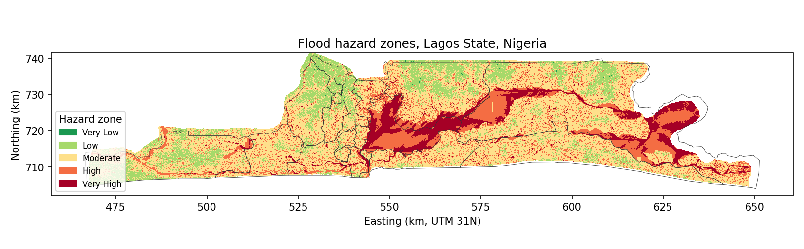
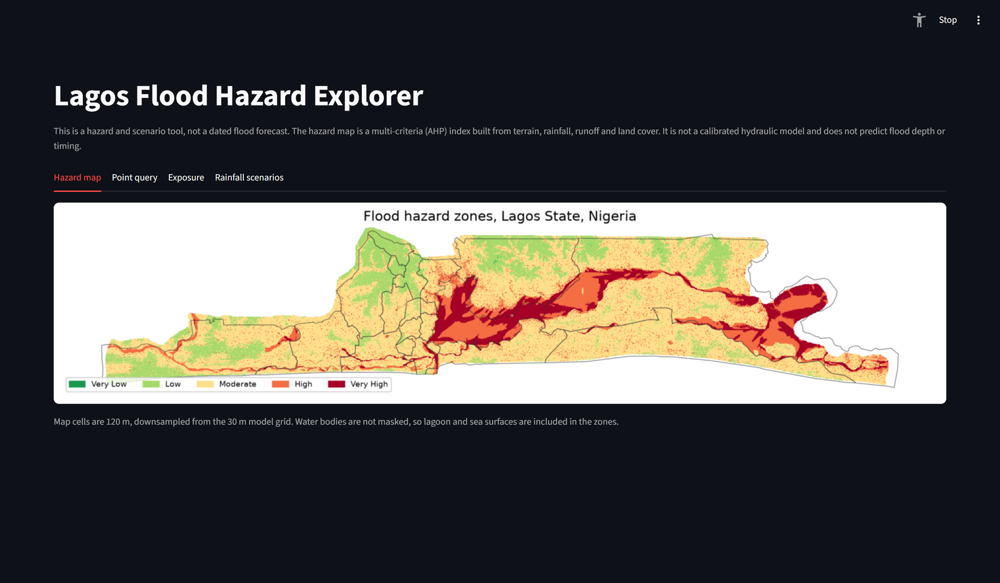
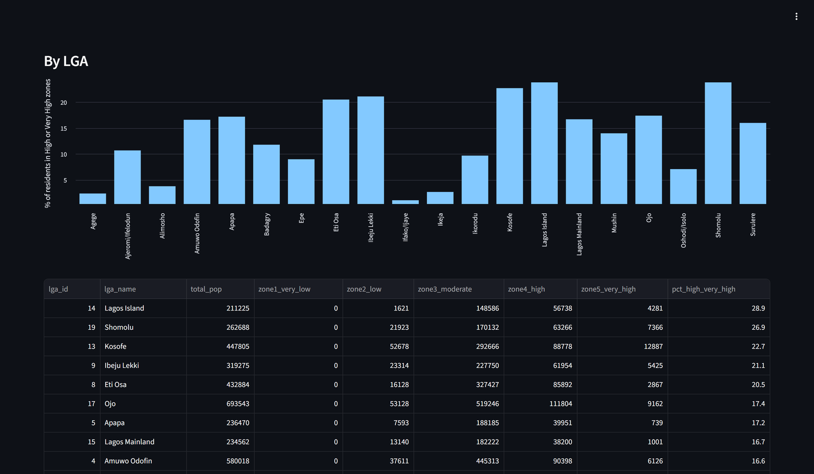
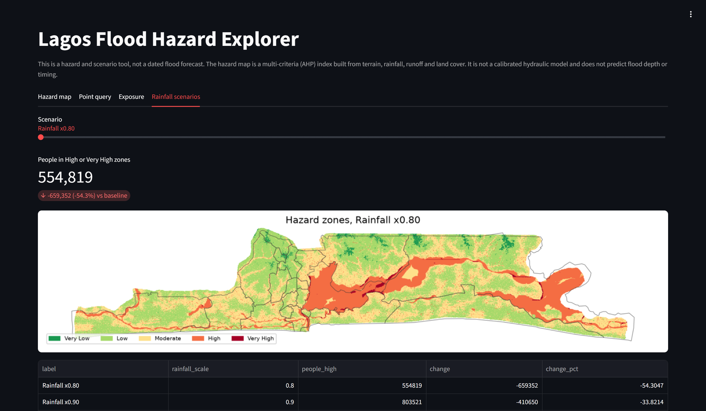
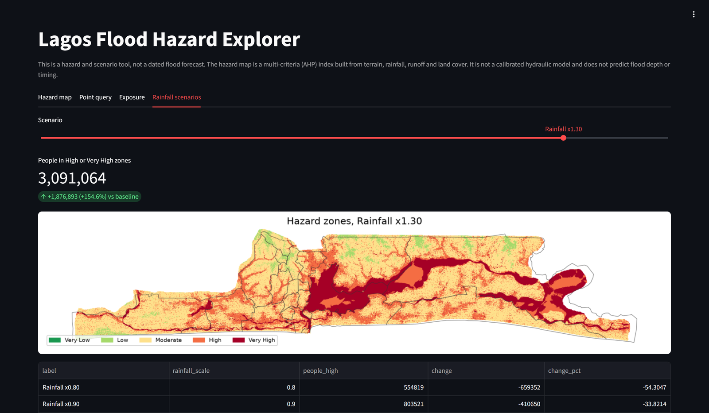
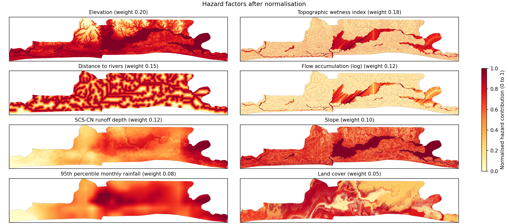
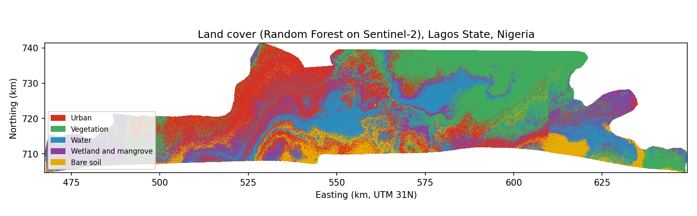
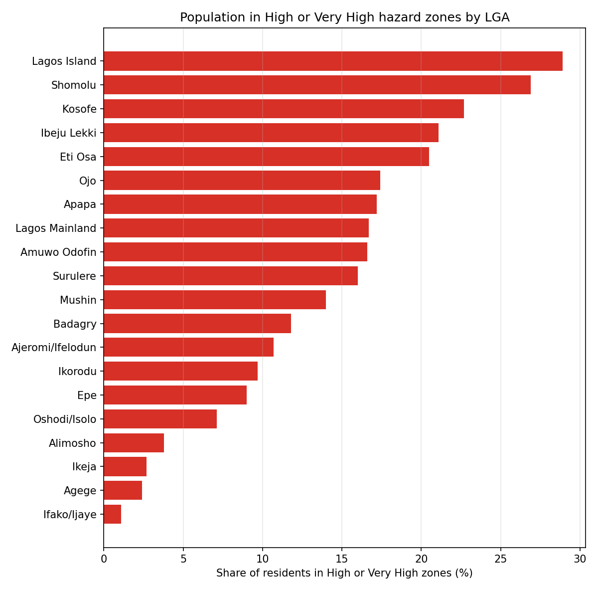
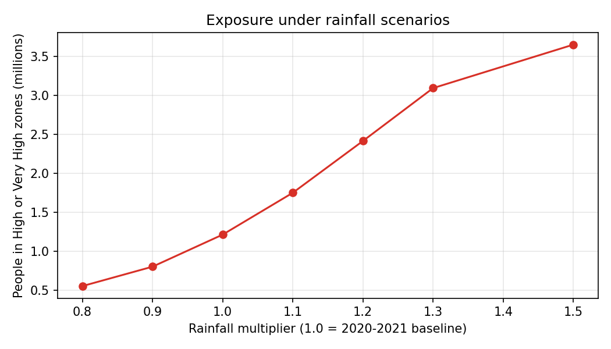

# Lagos Flood Hazard Explorer

[](https://github.com/jubemi-pajiah/lagos-flood-hazard-explorer/actions/workflows/ci.yml)
[](LICENSE)


A flood hazard and population exposure model for Lagos State, Nigeria, with a small
Streamlit app. The model combines eight terrain, rainfall, runoff and land cover factors
into an AHP hazard index at 30 m, counts the people living in each hazard zone by Local
Government Area (LGA), and precomputes rainfall scenarios. The pipeline is driven by one
region file, so the same code can be run for other places.



**Live demo: [lagos-flood-hazard-explorer.onrender.com](https://lagos-flood-hazard-explorer.onrender.com)**
(hosted on a free plan; the first load after a quiet spell can take up to a minute)

## What it does

* Builds a 30 m hazard index from elevation, topographic wetness, distance to rivers,
  flow accumulation, SCS-CN runoff, slope, rainfall and land cover, and splits it into
  five zones.
* Classifies land cover from Sentinel-2 with a Random Forest trained on ESA WorldCover.
* Counts residents per hazard zone, statewide and for each of the 20 LGAs.
* Checks the map against 20 documented flood locations and tests runoff sensitivity.
* Precomputes seven rainfall scenarios (0.8 to 1.5 times the baseline).
* Serves a hazard map, point query, exposure tables and scenarios in a Streamlit app that
  reads only small precomputed files.

## The app

Four tabs: the hazard map, a point query (zone, index and LGA for any coordinate),
exposure by LGA, and rainfall scenarios. It reads only precomputed files, so it runs in
about 200 MB of memory.





| Rainfall x0.80 | Rainfall x1.30 |
|---|---|
|  |  |

## Quick start

The pipeline needs rasterio and geopandas, which install most easily from conda-forge:

```
conda env create -f environment.yml
conda activate flood
```

Point `FLOOD_DATA_DIR` at the folder that holds the raw data (the paths inside it are
listed in `regions/lagos.yaml`; about 4 GB for Lagos):

```
export FLOOD_DATA_DIR=/path/to/raw/data          # PowerShell: $env:FLOOD_DATA_DIR = "..."
python -m flood run --region lagos               # whole pipeline, skips up-to-date stages
python -m flood run --region lagos --stage hazard   # one stage
python -m flood run --region lagos --force       # rerun everything
python -m flood status --region lagos            # what is up to date
```

The terrain stage calls GRASS GIS through QGIS's `qgis_process`. Install QGIS (it ships
GRASS) and, if it is not found automatically, set `FLOOD_QGIS_PROCESS` to the path of
`qgis_process`. A full run takes about an hour on a 4-core PC, most of it land cover.

Run the app (needs only `requirements.txt`, not the raw data):

```
pip install -r requirements.txt
streamlit run app/app.py
```

To host it (for example on Render), use `pip install -r requirements.txt` as the build
command and `streamlit run app/app.py --server.port $PORT --server.address 0.0.0.0
--server.headless true` as the start command.

## Architecture

```
regions/lagos.yaml  ->  flood/ stages  ->  outputs/lagos/  (generated, not committed)
                                       ->  app/data/lagos/ (small, committed)  ->  flood/api.py  ->  app/app.py
```

Stages run in order: `preprocess`, `terrain`, `climate`, `landcover`, `runoff`, `hazard`,
`exposure`, `validation`, `scenarios`, `figures`. Each declares its inputs, outputs and
the config sections it depends on, and is skipped when nothing has changed. Region
settings (grid, data paths, factor weights and AHP matrix, land cover scores, curve
numbers) all live in the yaml file. See [docs/architecture.md](docs/architecture.md).

## Method

Continuous factors are rescaled to 0-1 between their 2nd and 98th percentiles (flow
accumulation after a log transform), reversed where low values mean more hazard, and
summed with these weights:

| Elevation | TWI | Distance to rivers | Flow accumulation | Runoff | Slope | Rainfall | Land cover |
|---|---|---|---|---|---|---|---|
| 0.20 | 0.18 | 0.15 | 0.12 | 0.12 | 0.10 | 0.08 | 0.05 |

The stored AHP pairwise matrix for these factors has lambda_max 8.286 and a consistency
ratio of 0.029. Zones break at 0.2, 0.4, 0.6 and 0.8. Runoff uses the SCS curve number
method on the 2021 rainy-season CHIRPS total; population is WorldPop / GRID3 bottom-up
estimates. Details in [docs/methods.md](docs/methods.md).



Land cover comes from a Random Forest on Sentinel-2 imagery (19 April 2026), trained on
ESA WorldCover labels:



## Results

| Zone | Area (km2) | of which water (km2) | Residents |
|---|---|---|---|
| Very Low | 3.4 | 0.1 | 18,975 |
| Low | 636.1 | 39.2 | 3,250,964 |
| Moderate | 1,954.7 | 237.5 | 5,831,148 |
| High | 808.2 | 266.1 | 1,139,718 |
| Very High | 363.3 | 159.3 | 74,453 |
| Total mapped | 3,765.7 | 702.2 | 10,315,258 |

* **1,214,171 people (11.8%)** live in High or Very High zones.
* High and Very High cover 31.1% of the mapped area, or 24.4% of land once water is
  excluded. 43.8% of the Very High zone is lagoon or sea.
* LGAs with the largest share of residents in High or Very High zones: Lagos Island
  (28.9%), Shomolu (26.9%), Kosofe (22.7%), Ibeju Lekki (21.1%) and Eti Osa (20.5%).
  Lowest: Ifako/Ijaye (1.1%).
* Of 20 documented flood locations, 6 fall in High or Very High zones and 19 in Moderate
  or above.
* Land cover accuracy on 15,000 holdout pixels: 51.8% (kappa 0.397).
* Rainfall scenarios: people in High or Very High zones range from 554,819 (0.8 times
  rainfall) to 3,091,064 (1.3 times) and 3,647,862 (1.5 times).





## Limitations

* The hazard map is an AHP multi-criteria index, not a calibrated hydraulic model. It
  ranks places; it does not predict depth, timing or probability of flooding.
* Land cover accuracy (51.8%) limits the precision of the land cover and runoff factors.
* The hotspot check compares the map with 20 documented flood locations. It has no
  non-flooded controls, so it is not a measure of skill.
* Water bodies are not masked: 159.3 km2 of the 363.3 km2 Very High zone is water. On
  land alone, High and Very High cover 746.1 km2 (24.4% of land).
* SCS-CN is driven by a seasonal rainfall total, not a design storm, giving a runoff
  coefficient of 0.95. Absolute runoff depths are not for design.
* SoilGrids has no clay value for 46% of Lagos cells; these are treated as the most
  permeable soil group, which understates runoff in built-up areas.
* Rainfall carries 0.20 of the index weight, but many populated cells sit just below the
  Moderate/High break, so scenario exposure moves sharply. Scenarios are a sensitivity
  test, not a forecast.
* Population is from WorldPop / GRID3 v1.2, released in 2020. LGA totals (10,338,873)
  are 23,615 higher than the mapped total because some edge cells have no hazard value.
* The deployed app shows zones and the hazard index at 120 m, taken from the centre
  30 m cell of each block. Per-factor values are not included in point queries, to keep
  the app small.

More in [docs/limitations.md](docs/limitations.md), including corrections made to an
earlier version of this analysis.

## Data sources and licences

| Data | Source | Licence |
|---|---|---|
| Elevation | SRTM 1 arc-second (NASA / USGS) | public domain |
| Rivers | HydroRIVERS v1.0 (Lehner and Grill 2013) | HydroSHEDS licence (free use with attribution) |
| Rainfall | CHIRPS v2.0 monthly (Funk et al. 2015) | free use with citation |
| Soil clay | SoilGrids 250 m (ISRIC) | CC BY 4.0 |
| Imagery | Sentinel-2 L2A (Copernicus) | Copernicus open licence |
| Land cover labels | ESA WorldCover 2021 v200 | CC BY 4.0 |
| Population | WorldPop / GRID3 bottom-up gridded population, Nigeria v1.2 | CC BY-SA 4.0 |
| Model boundaries | GADM levels 1 and 2 | not redistributed; read from `FLOOD_DATA_DIR` |
| App LGA outlines | geoBoundaries NGA ADM2 (GRID3) | CC BY 4.0 |

Only small files are committed; see [data/README.md](data/README.md). Raw data stays
outside the repository.

## Adding a region

Write a new yaml file in `regions/`, download the inputs, and run the pipeline. No code
changes are needed. Step by step in [docs/adding-a-region.md](docs/adding-a-region.md);
new hazard factors in [docs/adding-a-factor.md](docs/adding-a-factor.md). Plans in
[docs/roadmap.md](docs/roadmap.md).

## Tests

```
pytest -m "not golden"          # unit tests, no data needed (run in CI)
pytest -m golden                # regression tests; need FLOOD_DATA_DIR, FLOOD_GOLDEN_DIR
                                # and a completed run in outputs/lagos
```

The golden tests check that the code reproduces an earlier run of this analysis from the
same intermediate rasters, and that a full run matches the published baseline in
`tests/golden/lagos/baseline`. Lint with `ruff check .` and `ruff format --check .`.

## Licence

Code under the MIT licence (see [LICENSE](LICENSE)). Data files keep their own licences
(table above).

## Contact

Jubemi Pajiah, [jubemi.com](https://jubemi.com), info@jubemi.com
